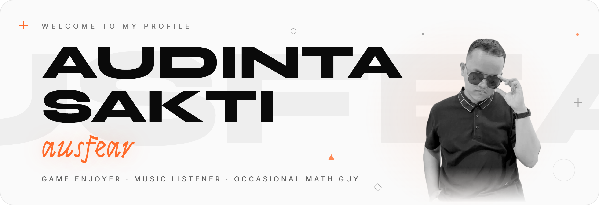

<picture>
  <source media="(prefers-color-scheme: dark)" srcset="portfolio/assets/readme/header-dark.png">
  
</picture>

### Hi, I'm Audinta

Most of the internet knows me as **ausfear**. I'm not a professional developer or designer. I just like making stuff on the internet for fun, playing the same song on repeat until it stops sounding like a song, and sinking way too many hours into games I'll never get good at.

#### Some facts, roughly in order of usefulness

- I finished a Mathematics degree in about 3.5 years. I still need ten seconds of complete silence to split a dinner bill.
- These days that degree mostly decides whether a 0.6% gacha banner rate is worth it. It never is. I still pull anyway.
- 4,894 hours on Steam, 1,832 of them in Counter-Strike 2. Every lost round was obviously lag.
- I own 295 games on Steam and have never opened 129 of them. I'm at peace with that.
- I play a bit of guitar, keyboard, and even the flute. Good enough for about thirty seconds, so please don't ask me to perform.

#### What's in this repo

My personal site, live at **[ausfear.vercel.app](https://ausfear.vercel.app)**. Among other things, it:

- plays previews of what I've been listening to, with a visualizer that actually follows the song
- shows a game collection pulled from my Steam library (the almost-5,000-hour problem, visualized)
- has a dark mode, for the 3 AM visits

Built with Next.js, React, Tailwind CSS and framer-motion. The code lives in [`portfolio/`](portfolio/), with setup notes in its [README](portfolio/README.md).

#### Say hi

Current status: telling myself "one more commit" for the fourth hour in a row.
